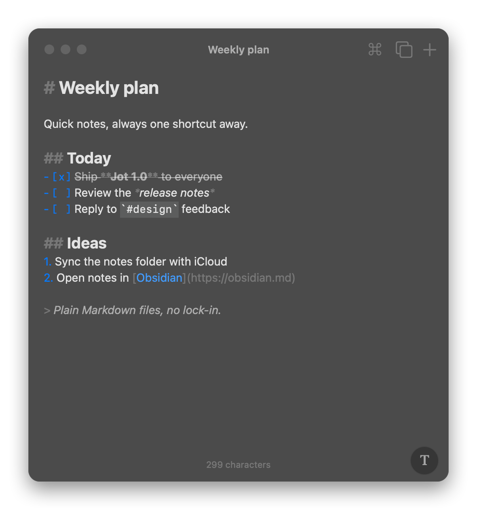
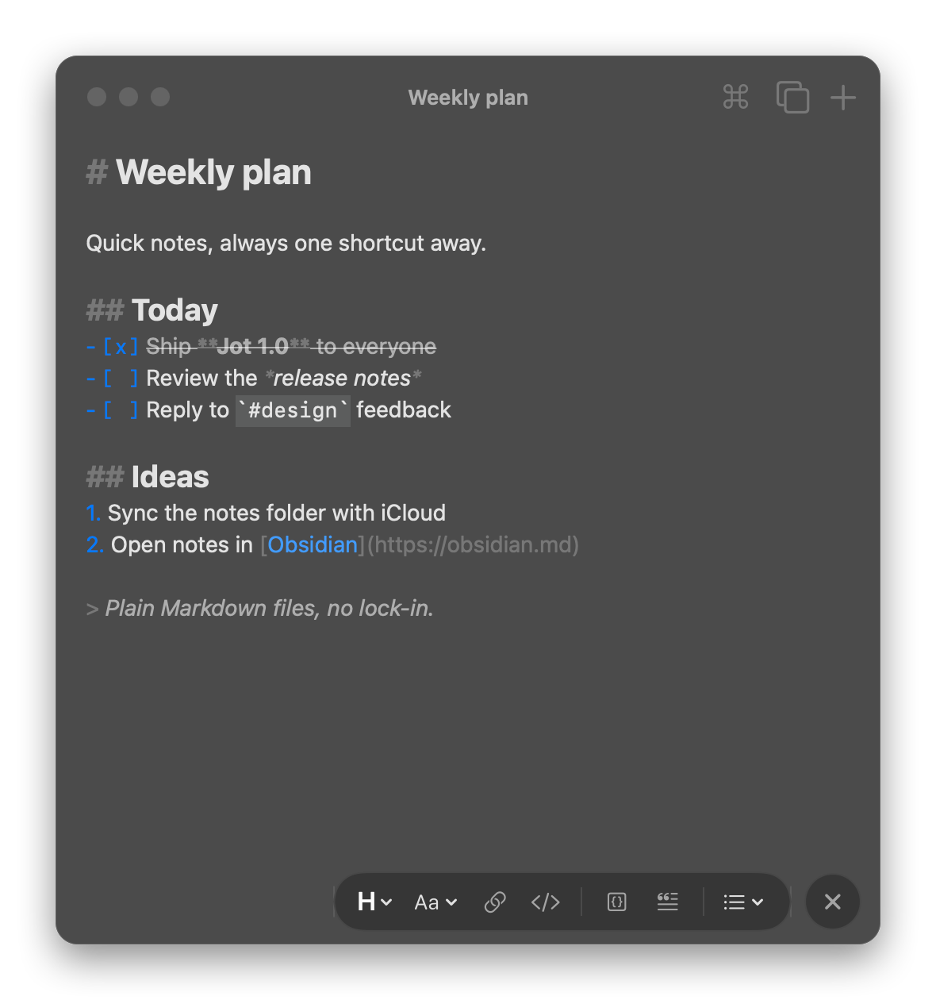

<p align="center">
  
</p>

<h1 align="center">Jot</h1>

<p align="center">
  <strong>A tiny, native Markdown scratchpad for the macOS menu bar.</strong><br>
  Unlimited notes, stored as plain <code>.md</code> files. A free alternative to Raycast Notes.
</p>

<p align="center">
  <a href="https://github.com/diogomgbrito/jot/releases/latest"></a>
  
  
  <a href="#install"></a>
</p>

<p align="center">
  
  
</p>

## Why Jot

Raycast Notes is great, but the free plan stops at five notes. Jot keeps the same quick-capture feel and drops the limit:

- **Always one click away.** Lives in the menu bar, floats above your work, hides with Esc.
- **Your notes are just files.** Plain Markdown in a folder you pick. Point it at an Obsidian vault, iCloud Drive or a git repo.
- **Markdown that stays out of the way.** Styled as you type, syntax still visible, no preview mode.
- **Native and light.** Swift and AppKit, no Electron, no account, no network.

## Install

```sh
brew tap diogomgbrito/jot https://github.com/diogomgbrito/jot
brew trust diogomgbrito/jot
brew install --cask jot
```

Update with `brew upgrade --cask jot`. Requires macOS 14 (Sonoma) or later, on Apple silicon or Intel.

> [!NOTE]
> Jot is not notarized by Apple. The Homebrew cask removes the quarantine flag so macOS lets it open.

## Getting started

1. Open Jot. A note icon appears in the menu bar.
2. **Left-click** it to show or hide the window; **right-click** for Settings and Quit.
3. Start typing. Notes save on their own.

**Open it from anywhere:** enable the global shortcut in Settings (⌘,), or bind Jot to a hotkey in Raycast. Launching Jot while it's running shows the window.

## Features

| | |
| --- | --- |
| 📝 **Live Markdown** | Headings, bold, italic, strikethrough, code, links, quotes and lists, styled as you type |
| ✅ **Smart lists** | Return continues lists, Tab indents, click `[ ]` to tick a task |
| 🔎 **Quick switcher** | ⌘P searches titles and content; Return on no match creates a note |
| 🎛 **Formatting bar** | The **T** button opens headings, styles, links, code and lists |
| 📂 **Plain files** | One `.md` file per note, in any folder you choose |
| 📥 **Import** | Bring in Markdown files, including notes exported from Raycast |
| ⚙️ **Settings** | Global shortcut, float on top, launch at login, notes folder |

## Shortcuts

| Keys | Action |
| --- | --- |
| Esc · ⌘W | Hide |
| Global shortcut (enable in Settings) | Show / hide Jot from anywhere |
| ⌘N | New note |
| ⌘P | Search / switch notes |
| ⌘[ · ⌘] | Previous / next note |
| ⇧⌘⌫ | Move note to Trash |
| ⇧⌘R | Reveal note in Finder |
| ⇧⌘I | Import Markdown files |
| ⌘F | Find in note |

<details>
<summary><strong>Formatting shortcuts</strong></summary>

| Keys | Action |
| --- | --- |
| ⌘B · ⌘I · ⇧⌘X | Bold · italic · strikethrough |
| ⌘K | Link |
| ⌥⌘C · ⌥⇧⌘C | Inline code · code block |
| ⌥⌘1–3 · ⌥⌘0 | Heading 1–3 · body text |
| ⇧⌘H | Cycle heading level |
| ⇧⌘8 · ⇧⌘7 · ⇧⌘L | Bulleted · numbered · checklist |
| ⇧⌘' | Quote |
| Tab · ⇧Tab | Indent · outdent list item |

List, quote and heading commands work on every selected line and toggle off when pressed again.

</details>

## Where your notes live

Notes are Markdown files in `~/Notes` by default. Change the folder in **Settings → Storage**; an iCloud Drive folder gives you sync across Macs.

- The filename is the creation time (`2026-10-13-101500.md`); the title is the first line.
- Edits save 400 ms after you stop typing, and when Jot hides or quits.
- Files changed by other apps are picked up the next time Jot opens.
- Empty notes are deleted when you switch away from them.

## Moving from Raycast Notes

Raycast stores notes in an encrypted database, so Jot can't read it directly. In Raycast Notes, open each note's actions (⌘K) and export it as Markdown. Then choose **Import Markdown Files…** in Jot (⇧⌘I or Settings). Files are copied, and Raycast keeps its notes.

## Build from source

Requires Xcode with Swift 5.10 or later.

```sh
git clone https://github.com/diogomgbrito/jot && cd jot
./scripts/bundle.sh --install   # builds, copies to ~/Applications/Jot.app, launches
```

`.build/debug/Jot --snapshot out.png [--format-open]` renders the window to a PNG and quits.

<details>
<summary><strong>Project layout</strong></summary>

- `Sources/Jot/AppDelegate.swift`: panel, toolbar, menus, status item, hotkey wiring
- `Sources/Jot/NoteStore.swift`: file-backed notes model
- `Sources/Jot/Editor.swift`: text view, Markdown highlighter, editing behaviours
- `Sources/Jot/Views.swift`: SwiftUI title, formatting bar, note switcher
- `Sources/Jot/Settings.swift`: preferences model and Settings window
- `Sources/Jot/HotKey.swift`: Carbon global hotkey
- `scripts/bundle.sh`: builds `Jot.app`
- `scripts/release.sh`: universal DMG for a release
- `scripts/make-icon.swift`: regenerates `Resources/AppIcon.icns`
- `Casks/jot.rb`: Homebrew cask

</details>

Releases are described in [RELEASING.md](RELEASING.md); changes in [CHANGELOG.md](CHANGELOG.md).
